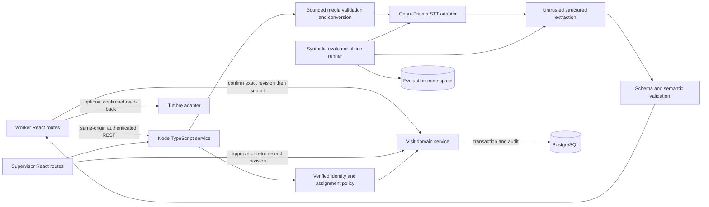
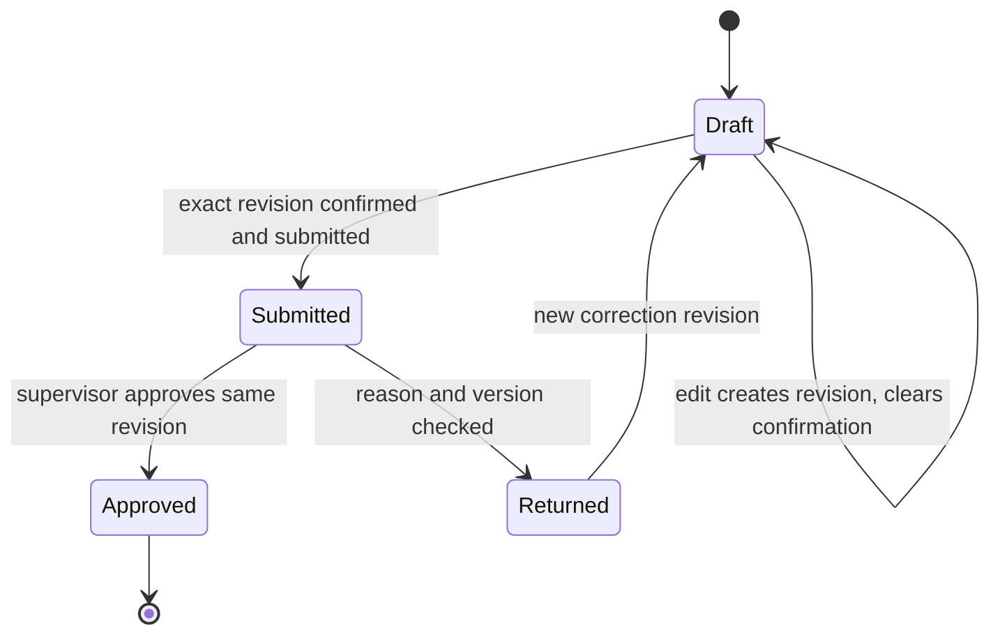

# Architecture

Status: proposed R2 design, no running services. [Decision log](DECISION_LOG.md) determines approval status. No migration from an existing application is needed; the repository is blank.

## Recommended boundaries

The diagram describes trust/data flow, not an implemented network topology. Browser talks to backend endpoints, never directly to credentialed provider adapters or PostgreSQL. Evaluator shares transcription/extraction code but has no visit-submission authority. One deployable backend is sufficient; no Redis/BullMQ, GPU, microservice or live WebSocket gateway is required initially.

## Dependency direction

`apps/web` → `packages/contracts`; `apps/api/routes` → identity policy + domain service; domain service → repository transaction; speech/extraction adapters → shared validated contract; evaluation → adapters + scorer, never visit-write routes. Only `packages/db` holds Prisma ORM access. “Prisma ORM” and “Gnani Prisma STT” are unrelated dependencies.

## Persistence and concurrency

Confirmation is metadata on an immutable revision, not a blanket status. Use optimistic version preconditions and an atomic state/audit/idempotency transaction. Do not hold a DB transaction open during a provider call. Persist proposed extraction only after validation; never let late provider responses overwrite manual edits. Queue state is not required for synchronous <=30s recording work; surface a retriable failure if bounded processing exceeds timeout.

## Alternatives and trade-offs

| Choice | Benefit | Drawback / rejected alternative |
|---|---|---|
| Short clips before streaming | Simple end-to-end proof and explicit stop boundary | Less live feedback; continuous partial form filling deferred behind provider/device evidence and scope approval. |
| Single backend/Postgres | Fewer services and consistent audit | Limits asynchronous throughput; use bounded concurrency, revisit jobs only after need is measured. |
| Pinned hosted extraction | Repeatable schema and fixture comparison | Vendor dependency; no silent model fallback. Fixture mode is labeled. |
| Deterministic UI prompts | Constrains advice-shaped model output | Less conversational; accepts human review as authority. |
| No durable browser audio | Removes uncertain storage/privacy work from critical path | Does not solve no-data capture; must be visible and human-approved. |

## Reliability/cost

Separate interactive demo and synthetic evaluation sessions; evaluator concurrency 1, explicit case count and budget. Retry provider failures only under bounded policy and authorized spend; never retry domain submission without idempotency. Health/readiness, request IDs and redacted operation timing are required. Audio staging is private, bounded and cleaned after success/failure with a crash sweep. Proposed 1-hour maximum staging retention needs human approval, not an implied clinical retention policy.

No autoscaling, multi-region, disaster-recovery SLA or clinical availability claim is justified yet. Shared-host/DB restore and fixture reset are planned local checks. Production/pilot requirements trigger a separate architecture review.
