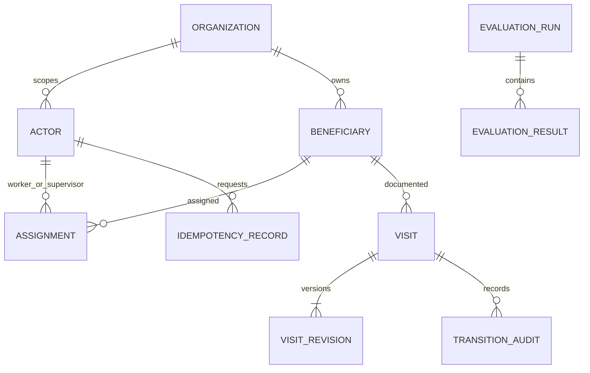

# Database design

Status: logical proposed schema, **no database or migrations created/executed**. Target PostgreSQL with Prisma ORM. No existing records to migrate. Synthetic-only scope and human approval gates apply.

## Entity contract

All IDs are server-generated opaque IDs. Times use UTC `timestamptz`; visit context also preserves timezone/offset for relative-date interpretation. Do not put real phone numbers/Aadhaar/PAN in any entity. Role is a server policy value, not a client edit.

| Entity | Planned fields / constraints |
|---|---|
| Organization | `id`, synthetic `label`. Single demo organization initially, but never omit organization scope from policy queries. |
| Actor | `id`, `organizationId`, `issuer`, `subject`, `role` (worker/supervisor), `active`; unique issuer+subject. No credentials copied into application rows. |
| Beneficiary | `id`, `organizationId`, unique synthetic `reference`, synthetic `displayName`; no real national ID/contact data. |
| Assignment | `id`, `organizationId`, `beneficiaryId`, `workerId`, `supervisorId`, `active`; indexed by worker and supervisor. Validate all references belong to one organization. |
| Visit | `id`, `organizationId`, `beneficiaryId`, `workerId`, `supervisorId`, `state`, `currentRevision`, `confirmedRevision` nullable, `createdAt`, `updatedAt`; state transitions only through domain service. |
| VisitRevision | Composite PK `visitId,revision`; `visitAt`, `visitTimezone`, `observations` JSONB, bounded `note`, synthetic `transcript`, `provenance`, unresolved acknowledgements, `contentHash`, `createdBy`, `createdAt`, `confirmedBy/At` nullable. Content immutable after creation; confirmation metadata binds to content hash/revision. |
| TransitionAudit | `id`, `visitId`, `revision`, `actorId`, `fromState`, `toState`, bounded return reason, request ID, timestamp; append-only, no raw audio/secret payloads. Confirmation/edit events also auditable. |
| IdempotencyRecord | Unique actor+operation+resource+key; request hash, durable original response/status/transition reference. Same key with changed body conflicts. Retain for visit lifecycle pending explicit retention policy. |
| EvaluationRun | Separate `evaluation` namespace: run ID, manifest hash, code/prompt/schema/model versions, seed/conditions, counts, status, timestamps. No foreign key or writer into clinical visit state. |
| EvaluationResult | `runId`, base scenario ID, split, condition, expected/predicted synthetic fields, result/error class, field denominator counts, timing; unique run+scenario+condition. |

Confirmed identity contexts are short-lived server/session-bound authorization context (provisional 10 minutes), not a permanent assertion that a name identifies a person. They bind actor, beneficiary and scope; expiry requires re-confirmation before history/draft access. Existing visits still require fresh server assignment checks, not a context token alone.

### Initial migration type/index specification

Use PostgreSQL `uuid` for IDs/FKs, `integer` for revisions, `timestamptz` for event times, `date` for confirmed follow-up dates, `text` for bounded strings, and `jsonb` for validated observations/provenance. `Visit.state` is restricted to draft/submitted/returned/approved; observation status is the four-value contract below. Application validation must reject unknown JSON keys and malformed tagged values. Proposed text limits: note 2,000 Unicode code points, return reason 1,000, synthetic display/reference 120/64. Transcript length is bounded by the 30s media contract plus a proposed 16,000-code-point response cap. These are engineering limits pending G1, not medical validation rules.

Create composite uniqueness `(id, organizationId)` on Actor and Beneficiary and organization-consistent compound FKs from Assignment/Visit. Index Assignment by `(organizationId, workerId, active)` and `(organizationId, supervisorId, active)`; Visit by `(organizationId, workerId, state, updatedAt)` and `(organizationId, supervisorId, state, updatedAt)`; TransitionAudit by `(visitId, createdAt)`. Revision PK `(visitId, revision)` is the stale-write boundary; idempotency's scoped unique key and evaluation's `(runId, scenarioId, condition)` unique key prevent duplicate logical operations/results. Server also checks that assigned actor roles match worker/supervisor; FK existence alone is not authorization.

## Observation semantics

For each approved field, a tagged status is `recorded`, `not_measured`, `unknown`, or `not_mentioned`. Only recorded observations have a typed value and unit where applicable. Never encode all missing states as zero or false. Initial fields are BP systolic/diastolic (integer mmHg pair), hemoglobin (normalized decimal string g/dL), reported TT-dose mention (bounded reported text, not generated schedule), optional worker-confirmed follow-up date (ISO date), and bounded visit note. Domain reviewer may narrow this before G1; clinical range thresholds are not invented.

Preserve negation, original expression/source span, visit time and historical/current distinction. Values supplied manually carry `source=manual`; LLM numeric confidence is not claimed calibrated. A fixed normalization spec must define equivalent decimal/date representations and reject ambiguous units/dates. Invalid/missing critical identity/time blocks submit; unresolved optional observations require explicit acknowledgement. Raw transcript is synthetic and access-scoped; it is never logged or made public by default.

## Transactions and race handling

On edit: check scoped actor and expected current revision/state, create new immutable revision, advance pointer, clear confirmation, append audit atomically. On confirmation: validate exact content/revision and unresolved acknowledgements, store confirmation metadata; stale revision fails. On submission: check confirmation+scope, transition state, append audit and write idempotent response in one transaction. On approve/return: check assigned supervisor and same submitted revision; one concurrent transition wins, later stale request conflicts. Returned records create a new draft revision before editing/resubmitting. Approved correction is out of scope.

Unique constraints and conditional writes are required even when application code checks first. Scope child revision/history queries through the parent visit/beneficiary; knowing a UUID does not confer access. Idempotency key expiry must not permit repeating an already completed state transition.

## Proposed migration sequence / rollback

1. `packages/db/prisma/schema.prisma` defines entities/constraints. T03 generates `packages/db/prisma/migrations/0001_initial/migration.sql` and reviews SQL before execution.
2. Apply only to a disposable local database; seed invented actors/beneficiaries/assignments. Test empty-database migration and repeat seed without duplicates.
3. Inspect unique keys, FK organization consistency and indexes. Test real transactions/concurrency rather than mocks for state races.
4. No down migration or production reset is authorized. Roll back application code while preserving additive schema; any future destructive change needs a reviewed backup/restore plan and human approval. In a disposable test DB only, recreate from migrations after confirming it contains no valuable data.

No migration command has been run in this council. Retention, encryption-at-rest/key ownership and any pilot export/delete rules remain human/domain decisions before real-world use.
